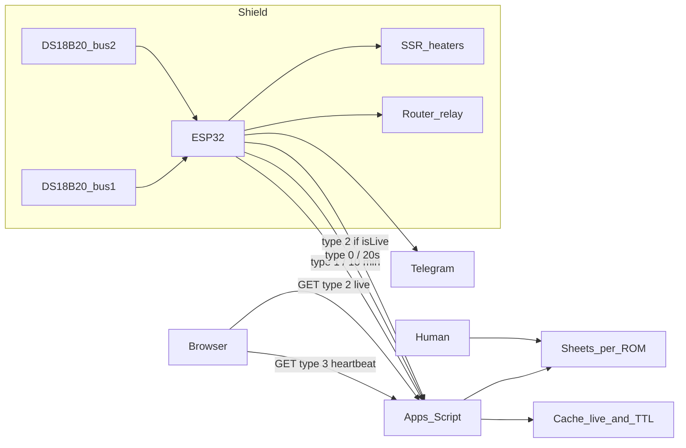

# План: smart-dch — мониторинг температуры

Источник истины — **код** в этом репозитории. Этот файл описывает текущее поведение системы. При правках синхронизировать [Cursor-план](c:\Users\araneus\.cursor\plans\esp32_temp_monitoring_408690d3.plan.md).

## Контекст и цель

Проект `smart-dch` (папка `smart-dachs`): PlatformIO, board `esp32dev`, Arduino ([platformio.ini](platformio.ini)).

**Железо:** ESP32 WROOM-32 (Type-C, CH340C, 30 pin, Wi-Fi); DS18B20 короткие и длинные 3–10 м; БП 5 В / 3 А; Wi-Fi в Интернет; протоплата; модуль 4 реле — GPIO25/26 нагрев, GPIO27 роутер, GPIO33 `RESERVE_RELAY_PIN` (в коде не используется). Этапы 1–5 **сделаны**, этап 6 — в коде.

**Делает система:** опрос DS18B20; история каждые 10 мин в Google Sheets (по листу на ROM); live в браузере, пока открыт дашборд; Telegram-алерты, если заданы токен и chat id; регулятор нагрева по ROM (`HEATER_SENSOR_ID_*`); перезагрузка роутера при потере **Интернета** > 10 мин.

**Стек:** свой код на ESP32; облако = Apps Script + Sheets; без VPS/VPN/HA. Дашборд — статические `dashboard/*.html`.

---

## Архитектура (как в коде)



- До **3** шин 1-Wire: `SENSOR_PIN_1`…`_3` ([include/config.h](include/config.h)). Пин `< 0` — слот пустой, пропускается. В `initSensors` заполненные пины собираются в `buses[]` (`busCount`). Сейчас заданы GPIO4 и GPIO16. До 10 датчиков суммарно (`MAX_SENSORS`).
- Опрос и Serial — каждые **3 с** (`SAMPLE_INTERVAL_MS`). Поиск новых ROM: в `initSensors` и **после** измерения в `pollSensors`. Известные ROM не удаляются. `t` округляется до 0,1 °C (`roundf(t * 10) / 10`).
- NTP (UTC+3): `startNtp()` после Wi-Fi, колбэк `sntp_set_time_sync_notification_cb`. Пока нет sync, `getHistorySlotId()` = **0**. Флаг `isLive` считает только Apps Script по TTL.
- История: POST type 1, если `getHistorySlotId() > lastHistorySlot` (`lastHistorySlot` стартует с 0). Слот = `time() / 600` (10 мин Unix). Первая запись сразу после NTP, дальше при смене слота. Скрипт округляет timestamp вниз до `…:x0:00` и пишет на лист ROM. Type 1 обновляет live-кэш (даже без дашборда).
- Live type 2: только если `isLive` и температура/состав сдвинулись (≥ 0,1 °C), не чаще 3 с; в том же цикле, что опрос. Если уже ушёл type 1 — type 2 в этом цикле не шлётся.
- Ping type 0 каждые **20 с**.
- Секрет API — URL Web App. JSON без ключа. `include/secrets.h` и `dashboard/config.js` в `.gitignore`.
- Дашборд: URL зашифрован, пароль на клиенте; heartbeat GET `?type=3` каждые 25 с; live GET `?type=2` каждые 3 с (JSONP).
- UI дашборда — русский.
- Нагреватели не зависят от Wi-Fi. Два канала: `HEATER_RELAY_PIN_1`/`_2` (GPIO25/26) + `HEATER_SENSOR_ID_1`/`_2` (16 hex). В `initHeaters` ROM один раз в 8 байт; `pollHeaters` — `findSensorByRom`. Нет пары пин + валидный ROM — канал не создаётся. Нет датчика или `ok == false` — выкл только этот канал. Гистерезис общий.
- Роутер (`router.*`): проверка Интернета после каждого облачного ping — успех Apps Script = ок; иначе TCP `1.1.1.1:53`, иначе HTTPS `generate_204`. Нет Wi-Fi или все три неудачны ≥ 10 мин → одна попытка обесточить роутер (реле НЗ). Apps Script упал, а TCP/HTTPS ок → одно Telegram «Apps Script недоступен». После восстановления Интернета и попытки reboot — Telegram с длительностью обрыва. Пин `< 0` — выкл.

---

## Контракт API

ESP32 шлёт POST с заголовком **`Content-Type: text/plain; charset=utf-8`** (не `application/json`: иначе Apps Script отвечает HTTP 400). Тело — JSON. Редирект `/exec` → `/dev/…`: для type 1 и 2 прошивка **не** ходит GET по Location; для ping (нужен `{isLive}`) — следует за 302 GET.

| type | Кто | Назначение | Тело / ответ |
|------|-----|------------|--------------|
| 0 | ESP32 POST | ping | `{ "type": 0 }` → `{ "isLive": true\|false }` |
| 1 | ESP32 POST | история + live-кэш | `sensors` → пишет листы ROM и Cache |
| 2 | ESP32 POST | live | `sensors` → Cache; без тела в GET — отдать снимок |
| 3 | браузер GET/POST | heartbeat | продлить TTL +60 с → `{ "isLive": true }` |

**Тело с датчиками (type 1 и 2):** только живые (`ok`), поля `id` (16 hex ROM) и `t` (°C). Timestamp в запросе нет.

**GET:** `?type=2` — снимок live; `?type=3` — heartbeat (дашборд). Опционально `callback=` для JSONP.

**CacheService:** снимок live; TTL до `Date.now()+60s`. Снаружи ping/heartbeat — только `isLive`.

**Sheets:** один лист на датчик, имя = ROM 16 hex.

- Строка 1 — свободная (заметки вручную).
- Строка 2 — заголовки `timestamp | t`.
- Данные с строки 3. `t` округлена до 0,1 °C (прошивка и скрипт), формат ячейки `0.0`.

Дашборд историю не читает. Общую картину по всем ROM даёт формула на отдельном листе (ниже).

Скрипт: [cloud/code.gs](cloud/code.gs). Деплой: Web App, Execute as Me, Anyone.

### Сводка: min(t) по timestamp на отдельном листе

**Задача.** История лежит на отдельных листах (имя = ROM), колонки `timestamp | t`. В таблице нет одной колонки «самая низкая температура в этот 10-минутный слот» (например холодная точка щита). Формула склеивает `A:B` со всех ROM и для каждого `timestamp` берёт `min(t)`.

**Как вставить**

1. В той же таблице создайте лист, например `min`. Имя **не** должно совпадать с ROM датчика: иначе `openSensorSheet_` начнёт писать историю на этот лист.
2. Скопируйте имена вкладок датчиков (16 hex) с ярлыков листов.
3. В ячейку **A1** вставьте формулу. Подставьте реальные имена листов вместо заглушек. Локаль RU/EU: разделитель аргументов `;`. В английской локали у `QUERY`/`FILTER` запятые; вертикальная склейка массива `{…;…}` в обоих случаях через `;`.
4. Диапазон **A3:B**: строка 1 — заметки, строка 2 — заголовок, данные с 3-й. Не берите `A2:B`, иначе слово `timestamp` попадёт в группировку.
5. Третий и следующие датчики — ещё одна строка `FILTER('ROM'!A3:B; 'ROM'!A3:A<>"")` внутри `{…}`.
6. Формат колонки A — дата-время, B — `0.0`. Оба исходных листа должны существовать, иначе `FILTER` выдаст ошибку.
7. Если в каком-то слоте одного датчика нет строки, `min` считается по тем, кто есть.

```text
=QUERY({
  FILTER('AAAAAAAAAAAAAAA1'!A3:B; 'AAAAAAAAAAAAAAA1'!A3:A<>"");
  FILTER('BBBBBBBBBBBBBBBB'!A3:B; 'BBBBBBBBBBBBBBBB'!A3:A<>"")
}; "select Col1, min(Col2) where Col1 is not null group by Col1 order by Col1 label min(Col2) 't'"; 0)
```

Колонка 1 — timestamp слота, колонка 2 — минимум `t` по датчикам в этот момент. По этой таблице можно строить график в Sheets.

---

## Прошивка

**Зависимости:** OneWire, DallasTemperature, ArduinoJson^7.

| Модуль | Файлы | Роль |
|--------|--------|------|
| Датчики | `sensors.*` | `initSensors` / `pollSensors`, ROM-id, статус UNKNOWN/OK/DISCONNECTED, алерты |
| Время | `app_time.*` | `startNtp` (SNTP-колбэк), `getHistorySlotId` = `time()/600` |
| Wi-Fi | `app_wifi.*` | `initWifi` / `pollWifi`, реконнект 15 с, «Wi-Fi connected» в Telegram |
| Облако | `cloud.*` | `pingCloud` (type 0), `sendCloud` (type 1/2) |
| Telegram | `telegram.*` | `sendTelegramMessage`, если токен и chat id не пустые |
| Нагреватели | `heaters.*` | `initHeaters` / `pollHeaters`; канал = `HEATER_RELAY_PIN` + ROM |
| Роутер | `router.*` | `initRouter` / `pollRouter`; реле питания при потере Интернета |
| Цикл | `main.cpp` | `setup`/`loop`: Wi-Fi → router → 3 с опрос/нагреватели → облако; ping 20 с |

Допустимая температура датчика: `SENSOR_T_MIN_C`…`SENSOR_T_MAX_C` (−55…+125). Алерты Telegram: `ALERT_TEMP_HIGH_C` 100 °C, `ALERT_TEMP_LOW_C` 0 °C; пропажа/возврат датчика; Wi-Fi connected (обрыв только в Serial).

`id` в JSON и в имени листа — ROM 16 hex.

---

## Этап 1 — сборка (шина GPIO4)

Питание датчиков **5 В**, DATA на шине 1 — **GPIO4 / D4**, подтяжка **4,7 кОм к 3,3 В** (на длинной линии — 2,2 кОм). Вторая шина — **GPIO16**, свой резистор к 3,3 В. Шина 3 в конфиге `-1` (рекомендуемый GPIO17); чтобы добавить — GPIO ≥ 0 и свой подтягивающий резистор.

Распиновка 30-pin (USB-C снизу, вид сверху): GND/VIN слева внизу; GND/3V3 справа внизу; **D4 = GPIO4**. GPIO16 часто подписан **RX2 / D16**. Сверять шелкографию. На **3V3** внешние 5 В не подавать.

**Цвета DS18B20:** красный VDD 5 В, чёрный GND, жёлтый (белый) DATA.

**Короткие кабели (≤1 м), одна шина GPIO4** — короткая звезда на клеммах +5V / GND / DATA допустима:

```text
БП 5 В (+) ──┬── VIN ESP32
             └── VDD DS18B20

БП 5 В (−) ──┬── GND ESP32
             └── GND DS18B20

DATA ──┬── GPIO4 (шина 1) или GPIO16 (шина 2)
       └── 4,7 кОм к 3V3  (отдельный резистор на каждую шину)
```

Не соединять 5 В с 3V3; DATA не на 5 В как питание.

**Приёмка:** листы с именами ROM (строка 1 пустая/заметки, строка 2 заголовки); первая история после NTP, дальше раз в 10 мин; timestamp `…:x0:00`; после heartbeat ESP шлёт type 2; без heartbeat `isLive` падает.

---

## Этап 2 — дашборд (сделано)

[dashboard/index.html](dashboard/index.html), [encrypt.html](dashboard/encrypt.html), [crypto.js](dashboard/crypto.js), gitignored `config.js` (пример: `config.example.js`).

- Русский UI: таблица ROM и t; история только в Sheets.
- Пароль расшифровывает URL.
- Heartbeat 25 с, live 3 с, JSONP.

---

## Этап 3 — Telegram (код готов)

Включено, если в `secrets.h` непустые `TELEGRAM_BOT_TOKEN` и `TELEGRAM_CHAT_ID`. Иначе `sendTelegramMessage` сразу `false`.

События: Wi-Fi connected; датчик пропал / снова на связи; T выше high / ниже low; температура в норме; Apps Script недоступен при живом Интернете; роутер перезагружен (после восстановления Интернета). Входящий `/status` нет.

---

## Этап 4 — длинные линии (сделано)

До 3 шин (`SENSOR_PIN_1`…`_3`). Короткие и длинные на **разных GPIO**, у каждой шины свой подтягивающий к 3,3 В (короткая ~4,7 кОм, длинная ~2,2 кОм); DATA шин не соединять.

- Daisy-chain на стволе; зонд — отвод от коробки, не звезда длинных лучей в GPIO.
- Витая пара: DATA с GND; питание отдельно; 100 нФ у удалённого датчика.
- Слаботочка отдельно от 220 В.

---

## Этап 5 — нагреватели (сделано)

SSR×2 на GPIO25 / GPIO26 + GND; силовая 220 В через автомат. Канал = `HEATER_RELAY_PIN_n` + `HEATER_SENSOR_ID_n` (16 hex). `pollHeaters` после `pollSensors`, без Wi-Fi. Гистерезис: вкл ниже `HEATER_ON_BELOW_C` (5 °C), выкл выше `HEATER_OFF_ABOVE_C` (10 °C). Нет датчика — выкл только этот канал.

По желанию позже: пороги в NVS, состояние реле в live, токены Telegram, новый деплой `code.gs` при смене скрипта.

---

## Этап 6 — перезагрузка роутера

**В коде.** Питание роутера через **нормально замкнутое** реле на `ROUTER_RELAY_PIN` (**GPIO27**). LOW на пине = катушка выкл = контакт замкнут = питание роутера ВКЛ; HIGH = размыкание = обесточивание.

1. Раз в `PING_INTERVAL_MS`: `pingCloud`. Успех → Интернет ок, сброс флага алерта Apps Script. Неудача → TCP к `ROUTER_TCP_HOST:PORT`, иначе HTTPS GET `ROUTER_HTTPS_URL`. Любой запасной успех = Интернет ок; если при этом Apps Script упал — один раз Telegram «Apps Script недоступен».
2. Нет Wi-Fi или все проверки неудачны → фиксируется `offlineSince`.
3. Обрыв ≥ 10 мин, попытки ещё не было — катушка ВКЛ на 10 с, затем ВЫКЛ (одна попытка на обрыв).
4. Wi-Fi reconnect ESP32 — как обычно.
5. Интернет снова есть после попытки reboot — Telegram «Роутер был перезагружен, время не в сети: N секунд».

Отключить: `#define ROUTER_RELAY_PIN -1`.

---

## Порядок

**Сделано:** прошивка, Apps Script, дашборд, Telegram-клиент, короткие и длинные 1-Wire (до 3 шин), нагреватели SSR×2, перезагрузка роутера по потере Интернета.
