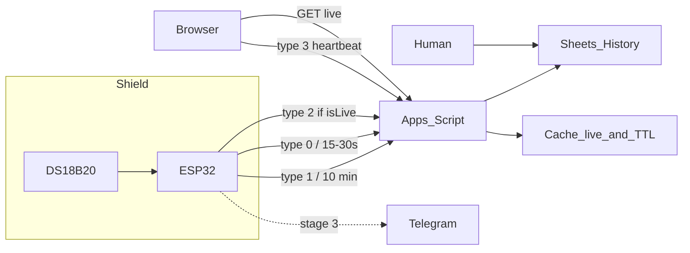

# План: smart-dch — мониторинг температуры

Копия рабочего плана: при правках [Cursor-плана](c:\Users\araneus\.cursor\plans\esp32_temp_monitoring_408690d3.plan.md) эту копию нужно синхронизировать вручную.

## Контекст и цель

Проект `smart-dch`: PlatformIO, board `esp32dev`, framework Arduino ([platformio.ini](platformio.ini)).

**Уже есть:** ESP32 WROOM-32 (Type-C, CH340C, 30 pin, Wi-Fi); 2× DS18B20 герметичных с кабелем 1 м; БП 5 В / 3 А с винтовыми клеммами; Wi-Fi с выходом в Интернет.

**Цель:** снимать температуру с датчиков; история на границах 10 мин (`…:x0:00`) в Google Sheets (просмотр в UI Sheets); live из браузера из любой точки мира по запросу (когда открыт дашборд); дальше — Telegram-алерты, до 10 проводных датчиков на одной плате, до 4 нагревателей 220 В в щитке.

**Ограничения стека:** свой код на ESP32; облако = Google Apps Script + Sheets (бесплатно); без VPS, VPN и готовых платформ умного дома. Установка постоянная в щитке, сборка на паяемой протоплате.

**Температура:** воздух, ориентир отображения −30…+100 °C; порог аварии для будущих уведомлений > +100 °C.

---

## Архитектура



- Все датчики на **одной** ESP32, шина **1-Wire** (проводные).
- Локальный опрос датчиков на плате — **каждые 2–5 с** всегда (контроль и будущие реле).
- В облако: история пачкой на границе **10 мин** локального времени (00, 10, 20…); в Sheets timestamp округляется до `мм:x0:00`. Live-снимки при `isLive === true` и изменении температуры ≥ 0,1 °C.
- Режим live включает браузер heartbeat’ом; ESP32 узнаёт режим ping’ом и получает **`isLive` (boolean)** — сравнение TTL только в Apps Script (NTP на ESP32 не требуется).
- Секрет API — **URL Web App** (Execute as Me / Anyone with link). В JSON отдельного ключа нет. URL не коммитить; таблица Sheets не публичная.
- ESP32 хранит Wi-Fi и URL в gitignored `secrets.h`.
- Дашборд (этап 2): URL API хранится **зашифрованным**; вход по паролю на клиенте; неверный пароль → неверный URL → API недоступен.
- UI дашборда и алертов — **русский**.

---

## Контракт API (ESP32 / браузер ↔ Apps Script)

`Content-Type: application/json`. Основные операции — **POST** в Web App.

**`type` (number):**

| type | Кто | Назначение | Тело / ответ |
|------|-----|------------|--------------|
| 0 | ESP32 | ping | тело `{ "type": 0 }` → `{ "isLive": true\|false }` |
| 1 | ESP32 | история | тело с `sensors` → OK; скрипт пишет строки в Sheets с `new Date()` |
| 2 | ESP32 | live | тело с `sensors` → OK; скрипт кладёт снимок в Cache |
| 3 | браузер | heartbeat | `{ "type": 3 }` → продлить TTL (например +60 с), ответ `{ "isLive": true }` |

**Тело с датчиками (type 1 и 2):**

```json
{
  "type": 1,
  "sensors": [
    { "id": "28382F49000000B6", "t": 23.5 },
    { "id": "28A13D490000006E", "t": 24.1 }
  ]
}
```

- `id` — ROM OneWire, 16 hex-символов.
- `t` — температура °C.
- Timestamp и имя датчика в запросе не передаются.

**GET:** `?type=2` — отдать live-снимок из Cache (для дашборда и отладки). Ping — через POST type 0.

**CacheService:** ключ снимка live; ключ внутреннего дедлайна TTL. Наружу для ping/heartbeat — только `isLive`.

**Лист Sheets `History`:** колонки `timestamp | id | t`. Пишет только скрипт при type 1; читает человек в UI Google Sheets (дашборд историю не запрашивает).

---

## Этап 1 — железо, прошивка, Apps Script

### 1.1 Компоненты и схема

**Закупка:** паяемая протоплата; винтовые клеммы (питание 2-пин, датчики 3-пин); резисторы 4,7 кОм; монтажный провод; провод от БП к плате; термоусадка/стяжки; USB-C при отсутствии.

Питание датчиков **5 В**, данные на **GPIO4**, подтяжка **4,7 кОм к 3,3 В**. На 30-pin плате ESP32-WROOM-32 Type-C CH340C подписи обычно такие (USB-C снизу, вид сверху):

- слева внизу: **GND**, **VIN** (иногда подписан **5V**)
- справа внизу: **GND**, **3V3**
- справа, выше GND: **D15**, **D2**, **D4** — **D4 = GPIO4**

Сверяйте с шелкографией своей платы. **VIN/5V** — вход 5 В на стабилизатор. **3V3** — выход 3,3 В. На **3V3** внешние 5 В не подавать.

**Цвета кабеля DS18B20** (типичные герметичные датчики):

| Провод | Назначение |
|--------|------------|
| красный | VDD (питание 5 В) |
| чёрный | GND |
| жёлтый (иногда белый) | DATA |

Перед пайкой прозвоните: между питанием и землёй не короткое замыкание. Если цвета нестандартные — ориентируйтесь на маркировку продавца.

**Подключение (2× DS18B20, кабели ≤1 м).** На протоплате три общие шины (клеммы): **+5V**, **GND**, **DATA**. Оба датчика параллельно на эти три клеммы (короткая звезда допустима).

```text
БП 5 В (+) ──┬── VIN платы ESP32
             └── VDD обоих DS18B20 (красные)

БП 5 В (−) ──┬── GND платы ESP32
             └── GND обоих DS18B20 (чёрные)

DS18B20 DATA (оба жёлтых) ──┬── GPIO4 / D4
                            └── один вывод резистора 4,7 кОм
3V3 платы ESP32 ────────────┘  второй вывод того же 4,7 кОм
```

1. **БП +5 В** → клемма **+5V** на протоплате → пин **VIN** (или **5V**) ESP32 и оба красных провода датчиков.
2. **БП GND** → клемма **GND** → любой **GND** ESP32 и оба чёрных провода датчиков. Земля БП, платы и датчиков — одна.
3. Оба жёлтых **DATA** → клемма **DATA** → пин **D4 / GPIO4**.
4. Резистор **4,7 кОм**: один вывод на **DATA**, второй на **3V3** ESP32. Один резистор на всю шину.

USB-C во время прошивки можно оставить. Если плата уже питается от VIN, часть клонов не любит одновременный USB и VIN — при странном поведении отключайте USB после заливки прошивки.

Не соединять: 5 В БП с пином **3V3**; DATA датчиков с 5 В как питание. GPIO0 / GPIO2 / EN для этой схемы не нужны.

**Проверка до включения 5 В:** между **VIN** и **GND** нет КЗ; между **DATA** и **GND** нет КЗ; между **DATA** и **3V3** сопротивление около 4,7 кОм; красные только на +5V, жёлтые только на DATA. После включения светодиод питания ESP32 горит, модуль не греется. В прошивке GPIO4 — пин 1-Wire.

### 1.2 Прошивка ESP32

**Зависимости** ([platformio.ini](platformio.ini)): `paulstoffregen/OneWire`, `milesburton/DallasTemperature`, `bblanchon/ArduinoJson`.

**Файлы:** `include/secrets.h` + `secrets.h.example` (WIFI_SSID, WIFI_PASSWORD, APPS_SCRIPT_URL); модули датчиков / Wi-Fi / HTTP; [src/main.cpp](src/main.cpp) — таймеры.

**Циклы:**

| Действие | Интервал |
|----------|----------|
| Опрос DS18B20 | 2–5 с |
| POST type 1 (все датчики) | на минутах, кратных 10 |
| POST type 0 → сохранить `isLive` | 15–30 с |
| POST type 2 | при `isLive` и изменении ≥ 0,1 °C (не чаще 10 с) |

Заложить массив до 10 датчиков (`id` + ROM).

### 1.3 Apps Script

Один проект, привязанный к таблице; Web App deploy.

- `doPost`: разбор JSON по `type` (0–3) как в контракте.
- `doGet`: выдача live при `type=2`.
- TTL heartbeat по умолчанию **60 с** с момента последнего type 3.

### 1.4 Приёмка этапа 1

- В `History` строки появляются около :00/:10/:20…; timestamp в таблице — `…:x0:00`.
- После POST type 3 ESP начинает слать type 2; `GET ?type=2` отдаёт актуальный JSON; после истечения TTL без heartbeat — `isLive: false`, type 2 прекращается.

---

## Этап 2 — Live-дашборд

Отдельная проработка UI позже; уже зафиксировано:

- Русский интерфейс: текущие температуры (и позже состояние реле); история — только через Sheets.
- Доступ: зашифрованный URL Web App + пароль на клиенте (неверный пароль → нерабочий URL).
- После входа: heartbeat type 3 каждые 20–30 с; чтение live каждые 2–5 с (`GET ?type=2`).
- Несколько вкладок продлевают один общий TTL на скрипте.
- Хостинг страницы и алгоритм шифрования URL — при детальном планировании этапа 2.

---

## Этап 3 — Telegram Bot

Отдельное планирование **после** дашборда. Уже зафиксировано:

- ESP32 → Telegram Bot API по HTTPS.
- Назначение: события/алерты (в т.ч. ориентир T > 100 °C, пропажа датчика, потеря Wi-Fi; позже — реле).
- Секреты: bot token, chat_id в `secrets.h`.
- Уточнить при планировании: полный список событий, тексты, антиспам, нужен ли входящий `/status`.

---

## Этап 4 — Датчики на 3–10 м (до 10 шт.)

- Одна плата; топология **daisy-chain**; питание датчиков **5 В**; подтяжка у ESP32 к **3,3 V**.
- У каждого удалённого датчика **100 нФ** VDD–GND.
- Кабель: витая пара / UTP + питание; слаботочка отдельно от силовых 220 В.
- При сбоях на полной загрузке: подтяжка 2,2 кОм или вторая шина на другом GPIO (например 5+5).
- **Докупки:** кабель, клеммы, 100 нФ × N, резисторы 4,7/2,2 кОм, дополнительные DS18B20.

---

## Этап 5 — Нагреватели

- **2** канала сейчас по плану, расширение до **4**; нагрузка **220 В**, обогрев щитка.
- Коммутация **SSR** (AC, вход 3–32 В DC).
- Логика на ESP32: вкл при T < T_on, выкл при T > T_off (гистерезис); при рестарте и потере связи — **выкл**.
- Пороги в NVS на плате; состояние реле — в live для дашборда; удалённая смена порогов — отдельное решение.
- Сила: отдельные клеммы, автомат/предохранитель, разделение с 1-Wire.
- **Покупки:** SSR ×2 (с запасом под ×4), нагреватели, силовые клеммы, защита линии, радиаторы к SSR при необходимости.

---

## Порядок работ

1. Закупка и сборка этапа 1.1.
2. Sheets + Apps Script + деплой Web App.
3. Прошивка этапа 1.2.
4. Приёмка 1.4.
5. Этапы 2 → 3 → при необходимости 4 и 5.
