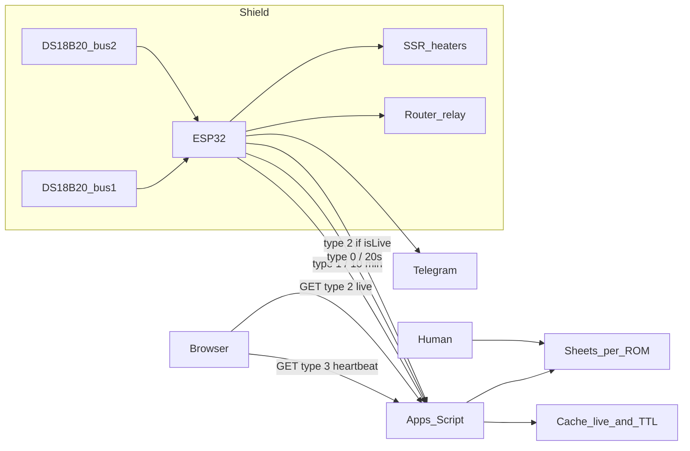

# План: smart-dch — мониторинг температуры

Источник истины — **код** в этом репозитории. Этот файл описывает текущее поведение системы. При правках синхронизировать [Cursor-план](c:\Users\araneus\.cursor\plans\esp32_temp_monitoring_408690d3.plan.md).

## Контекст и цель

Проект `smart-dch` (папка `smart-dachs`): PlatformIO, board `esp32dev`, Arduino ([platformio.ini](platformio.ini)).

**Железо:** ESP32 WROOM-32 (Type-C, CH340C, 30 pin, Wi-Fi); DS18B20 короткие и длинные 3–10 м; БП 5 В / 3 А; Wi-Fi в Интернет; протоплата; модуль 4 реле — GPIO25/26 нагрев, GPIO27 роутер, GPIO33 `RESERVE_RELAY_PIN` (в коде не используется). Этапы 1–5 **сделаны**, этап 6 — в коде.

**Делает система:** опрос DS18B20; история каждые 10 мин в Google Sheets (лист = `id` из карты или ROM); live в браузере, пока открыт дашборд; Telegram-алерты, если заданы токен и chat id; регулятор нагрева по ROM (`HEATER_SENSOR_ROM_*`); перезагрузка роутера при потере **Интернета** > 10 мин.

**Стек:** свой код на ESP32; облако = Apps Script + Sheets; без VPS/VPN/HA. Дашборд — Astro + Tailwind (`dashboard/`), деплой GitHub Pages.

---

## Архитектура (как в коде)



- До **3** шин 1-Wire: `SENSOR_PIN_1`…`_3` ([include/config.h](include/config.h)). Пин `< 0` — слот пустой, пропускается. В `initSensors` заполненные пины собираются в `buses[]` (`busCount`). Раскладка: `SENSOR_PIN_1` GPIO4 — короткая, **4,7 кОм**; `_2` GPIO16 и `_3` GPIO17 — длинные, **2,2 кОм** (каждая к 3,3 В). До 10 датчиков суммарно (`MAX_SENSORS`).
- Опрос и Serial — каждые **3 с** (`SAMPLE_INTERVAL_MS`). Поиск новых ROM: в `initSensors` и **после** измерения в `pollSensors`. Известные ROM не удаляются. `t` округляется до 0,1 °C (`roundf(t * 10) / 10`).
- NTP (UTC+3): `startNtp()` после Wi-Fi, колбэк `sntp_set_time_sync_notification_cb`. Пока нет sync, `getHistorySlotId()` = **0**. Флаг `isLive` считает только Apps Script по TTL.
- История: POST type 1 при смене 10‑мин слота (`getHistorySlotId()` = `time() / 600`). `lastHistorySlot` стартует с 0; после NTP текущий слот только запоминается (без отправки), первая запись — на границе следующего слота, дальше при каждой смене. Скрипт округляет timestamp вниз до `…:x0:00` и пишет на лист ROM. Type 1 обновляет live-кэш (даже без дашборда).
- Live type 2: только если `isLive` и температура/состав сдвинулись (≥ 0,1 °C), не чаще 3 с; в том же цикле, что опрос. Если уже ушёл type 1 — type 2 в этом цикле не шлётся.
- Ping type 0 каждые **20 с**.
- Секрет API — URL Web App. JSON без ключа. `include/secrets.h` в `.gitignore`. Дашборд: `DASHBOARD_API_URL` + `DASHBOARD_PASSWORD` в `.env` / GitHub Secrets; prebuild шифрует → `PUBLIC_DASHBOARD_CIPHER` в статике.
- Дашборд: URL зашифрован, пароль на клиенте; heartbeat GET `?type=3` каждые 25 с; live GET `?type=2` каждые 3 с (JSONP).
- UI дашборда — русский, liquid glass; `/` live, `/settings` — имя/скрытие датчиков (localStorage).
- Карта датчиков `SENSOR_LABEL_MAP`: `S("ROM16hex", "label", "id")`. При обнаружении → `SensorReading.label` / `.id` (пустые строки → `nullptr`). Telegram: `label` или ROM hex. Облако: JSON `id` = map `id` или ROM hex.
- Нагреватели не зависят от Wi-Fi. Два канала: `HEATER_RELAY_PIN_1`/`_2` (GPIO25/26) + `HEATER_SENSOR_ROM_1`/`_2` (16 hex). В `initHeaters` ROM один раз в 8 байт; `pollHeaters` — `findSensorByRom`. Нет пары пин + валидный ROM — канал не создаётся. Нет датчика или `ok == false` — выкл только этот канал. Гистерезис общий.
- Роутер (`router.*`): проверка Интернета после каждого облачного ping — успех Apps Script = ок; иначе TCP `1.1.1.1:53`, иначе HTTPS `generate_204`. Нет Wi-Fi или все три неудачны ≥ 10 мин → одна попытка обесточить роутер (реле НЗ). Apps Script: после `APPS_SCRIPT_FAILS_BEFORE_ALERT` (3) неудачных ping подряд при живом Интернете — Telegram «Apps Script недоступен»; при восстановлении — «Apps Script снова доступен». После reboot роутера — Telegram с длительностью обрыва. Пин `< 0` — выкл.

---

## Контракт API

Транспорт: JSON. ESP32 шлёт **POST** с **`Content-Type: text/plain; charset=utf-8`** (не `application/json` — иначе Apps Script отвечает HTTP 400). Браузер — **GET** `?type=…`, опционально `callback=` (JSONP). Редирект `/exec` → `/dev/…`: для type 1 и 2 прошивка **не** ходит GET по Location; для ping (нужен ответ с `isLive`) — следует за 302 GET.

Скрипт: [cloud/code.gs](cloud/code.gs) (`Code.gs`). Деплой: Web App, Execute as Me, Anyone.

### Сущности (типы полей)

| Сущность | Поля | Типы / формат |
|----------|------|----------------|
| **Запрос** | `type` | number: `0`…`3` |
| | `sensors` | array объектов **Sensor** (только type 1 и 2 с ESP; у GET type 2 поля нет) |
| **Sensor** | `id` | string — логический id из `SENSOR_LABEL_MAP` или, если пуст, ROM 16 hex; имя листа Sheets и колонка дашборда |
| | `t` | number, °C, шаг 0,1 (прошивка и `normalizeSensorRows_`) |
| **Ответ ping / heartbeat** | `isLive` | boolean — открыт ли дашборд (TTL) |
| **Ответ записи** (POST 1/2) | `ok` | boolean `true` |
| **Ответ live** (GET type 2) | `sensors` | array **Sensor** (из Cache; пусто → `[]`) |
| **Ошибка** | `ok`, `error` | `false` + string |

Термины: **ROM** — аппаратный адрес 1-Wire (16 hex); **label** — текст Telegram; **id** — идентификатор в облаке/Sheets (только из карты, иначе подставляется ROM). В JSON поле всегда называется `id`.

В облако **не** уходят: сырой ROM отдельным полем, `ok`/`status`, шина, `label`, timestamp (ставит скрипт при истории), состояние реле.

ESP в type 1/2 кладёт только датчики с `ok == true`. Если таких нет — POST **не** отправляется (`sendCloud` skip). Скрипт при разборе пропускает элементы без `id`/`t` или с нечисловым `t`.

### Примеры JSON

**Type 0 — ping (ESP → облако → ESP)**

```json
{"type":0}
```

```json
{"isLive":true}
```

**Type 1 / 2 — запись с датчиками (ESP → облако)**

```json
{
  "type": 1,
  "sensors": [
    {"id": "shield1", "t": 24.5},
    {"id": "shield2", "t": 28.9}
  ]
}
```

Ответ: `{"ok":true}` (тело после редиректа прошивка type 1/2 может не читать).

**Type 2 — чтение live (браузер GET `?type=2`)**

```json
{
  "sensors": [
    {"id": "shield1", "t": 24.5},
    {"id": "shield2", "t": 28.9}
  ]
}
```

**Type 3 — heartbeat (браузер GET `?type=3`)** → `{"isLive":true}`; TTL в Cache +60 с.

### Кто что делает

| type | Кто | Назначение |
|------|-----|------------|
| 0 | ESP POST | ping: узнать `isLive` |
| 1 | ESP POST | история в Sheets + обновить live-кэш |
| 2 | ESP POST | только live-кэш; GET без `sensors` — отдать кэш |
| 3 | браузер GET | heartbeat, продлить TTL |

**CacheService:** ключ live = `{ "sensors": [ Sensor, … ] }`; ключ TTL = unix ms до `Date.now()+60s`. Снаружи ping/heartbeat отдают только `isLive`.

**Sheets:** один лист на датчик, имя = JSON `id` (из карты или ROM). Строка 1 — заметки; строка 2 — `timestamp | t`; данные с строки 3. Timestamp — время сервера, округлённое вниз до 10 мин (`…:x0:00`); `t` — number, формат ячейки `0.0`. Смена `id` в карте создаёт **новый** лист (старый с именем ROM не дополняется).

Дашборд историю не читает (только GET type 2/3). Сводку по всем датчикам — формула на отдельном листе (ниже).

### Сводка: min(t) по timestamp на отдельном листе

**Задача.** История на отдельных листах (имя = `id`), колонки `timestamp | t`. Нужна колонка «самая низкая температура в этот 10-минутный слот». Формула склеивает `A:B` со всех листов датчиков и для каждого `timestamp` берёт `min(t)`.

**Как вставить**

1. В той же таблице создайте лист, например `min`. Имя **не** должно совпадать с `id` датчика: иначе `openSensorSheet_` начнёт писать историю на этот лист.
2. Скопируйте имена вкладок датчиков (`id`) с ярлыков листов.
3. В ячейку **A1** вставьте формулу. Подставьте реальные имена листов вместо заглушек. Локаль RU/EU: разделитель аргументов `;`. В английской локали у `QUERY`/`FILTER` запятые; вертикальная склейка массива `{…;…}` в обоих случаях через `;`.
4. Диапазон **A3:B**: строка 1 — заметки, строка 2 — заголовок, данные с 3-й. Не берите `A2:B`, иначе слово `timestamp` попадёт в группировку.
5. Третий и следующие датчики — ещё одна строка `FILTER('id'!A3:B; 'id'!A3:A<>"")` внутри `{…}`.
6. Формат колонки A — дата-время, B — `0.0`. Оба исходных листа должны существовать, иначе `FILTER` выдаст ошибку.
7. Если в каком-то слоте одного датчика нет строки, `min` считается по тем, кто есть.

```text
=QUERY({
  FILTER('shield1'!A3:B; 'shield1'!A3:A<>"");
  FILTER('shield2'!A3:B; 'shield2'!A3:A<>"")
}; "select Col1, min(Col2) where Col1 is not null group by Col1 order by Col1 label min(Col2) 't'"; 0)
```

Колонка 1 — timestamp слота, колонка 2 — минимум `t` по датчикам в этот момент. По этой таблице можно строить график в Sheets.

---

## Прошивка

**Зависимости:** OneWire, DallasTemperature, ArduinoJson^7.

| Модуль | Файлы | Роль |
|--------|--------|------|
| Датчики | `sensors.*` | `initSensors` / `pollSensors`, ROM + label/id из карты, статус UNKNOWN/OK/DISCONNECTED, алерты |
| Время | `app_time.*` | `startNtp` (SNTP-колбэк), `getHistorySlotId` = `time()/600` |
| Wi-Fi | `app_wifi.*` | `initWifi` / `pollWifi`, реконнект 15 с; TG «Wi-Fi connected» только после boot ESP или reboot роутера (`armWifiConnectedAnnounce`) |
| Облако | `cloud.*` | `pingCloud` (type 0), `sendCloud` (type 1/2); JSON `id` из карты или ROM |
| Telegram | `telegram.*` | `sendTelegramMessage`, если токен и chat id не пустые |
| Нагреватели | `heaters.*` | `initHeaters` / `pollHeaters`; канал = `HEATER_RELAY_PIN` + `HEATER_SENSOR_ROM`; TG high/low/норме только для этих датчиков + статус обогрева |
| Роутер | `router.*` | `initRouter` / `pollRouter`; реле питания при потере Интернета |
| Цикл | `main.cpp` | Wi-Fi → router → опрос/нагреватели → облако; ping 20 с; WDT 120 с |

Допустимая температура датчика: `SENSOR_T_MIN_C`…`SENSOR_T_MAX_C` (−55…+125). TG: связь потеряна / снова на связи — любой датчик; high/low/`Температура в норме` + «обогрев вкл/выкл» — только каналы нагревателей (`ALERT_TEMP_*`); Wi-Fi connected после boot/reboot роутера; Wi-Fi lost при каждом обрыве.

---

## Этап 1 — сборка (шина GPIO4)

Питание датчиков **5 В**. Подтяжка DATA **к 3,3 В**, отдельный резистор на каждую шину: `SENSOR_PIN_1` **GPIO4** — короткая линия, **4,7 кОм**; `SENSOR_PIN_2` **GPIO16** и `SENSOR_PIN_3` **GPIO17** — длинные, **2,2 кОм**. Пин `< 0` — слот выключен.

Распиновка 30-pin (USB-C снизу, вид сверху): GND/VIN слева внизу; GND/3V3 справа внизу; **D4 = GPIO4**. GPIO16/17 часто **RX2/TX2** (D16/D17). Сверять шелкографию. На **3V3** внешние 5 В не подавать.

**Цвета DS18B20:** красный VDD 5 В, чёрный GND, жёлтый (белый) DATA.

**Короткие кабели (≤1 м), одна шина GPIO4** — короткая звезда на клеммах +5V / GND / DATA допустима:

```text
БП 5 В (+) ──┬── VIN ESP32
             └── VDD DS18B20

БП 5 В (−) ──┬── GND ESP32
             └── GND DS18B20

DATA шина 1 ──┬── GPIO4
              └── 4,7 кОм → 3V3   (короткая)

DATA шина 2 ──┬── GPIO16
DATA шина 3 ──┼── GPIO17
              └── 2,2 кОм → 3V3   (длинная; свой резистор на каждую шину)
```

Не соединять 5 В с 3V3; DATA не на 5 В как питание.

**Приёмка:** листы с именами `id` (или ROM, если id в карте пуст); строка 1 пустая/заметки, строка 2 заголовки; первая история на границе следующего 10‑мин слота после NTP, дальше раз в 10 мин; timestamp `…:x0:00`; после heartbeat ESP шлёт type 2; без heartbeat `isLive` падает.

---

## Этап 2 — дашборд (сделано)

Astro + Tailwind в [dashboard/](dashboard/); Pages: [.github/workflows/deploy-dashboard.yml](.github/workflows/deploy-dashboard.yml).

- `/` — live-карточки; `/settings` — имя/скрытие датчиков.
- Prebuild (`scripts/with-cipher.mjs`): URL+пароль → cipher в бандл; пароль на клиенте расшифровывает URL.
- Heartbeat 25 с, live 3 с, JSONP; история только в Sheets.
- `BASE_PATH` / `SITE_URL` — заглушка `/smart-dachs` локально; в CI из имени репо (или vars).

---

## Этап 3 — Telegram (код готов)

Включено, если в `secrets.h` непустые `TELEGRAM_BOT_TOKEN` и `TELEGRAM_CHAT_ID`. Иначе `sendTelegramMessage` сразу `false`.

### Как создать бота и подключить

1. В Telegram откройте [@BotFather](https://t.me/BotFather) → `/newbot` → имя и username бота (username должен заканчиваться на `bot`).
2. BotFather пришлёт **token** вида `123456:ABC-DEF...` — это `TELEGRAM_BOT_TOKEN`. Никому не отправляйте и не коммитьте.
3. Напишите своему боту `/start` (иначе он не сможет писать вам первым, и chat id не появится в API).
4. Узнайте **chat id**:
   1) в браузере откройте `https://api.telegram.org/bot` + token без пробелов + `/getUpdates`  
      (пример: token `712345:AAHxx` → `https://api.telegram.org/bot712345:AAHxx/getUpdates`);
   2) в JSON найдите `"chat":{"id":…}` — число после `"id":` до запятой (не блок `"from"`; для группы id часто отрицательный);
   3) если `{"ok":true,"result":[]}` — снова `/start` боту и обновите страницу.
5. В `include/secrets.h` (из [secrets.h.example](include/secrets.h.example), файл в `.gitignore`):

```cpp
#define TELEGRAM_BOT_TOKEN "712345:AAHxx"
#define TELEGRAM_CHAT_ID   "111222333"
```

`TELEGRAM_CHAT_ID` — это число из шага 4 в кавычках.
6. Прошейте ESP32. При подключении к Wi-Fi должно прийти `Wi-Fi connected`. Нет сообщения — проверьте token, chat id, шаг 3 и Serial.

События: Wi-Fi connected (только после boot ESP или reboot роутера) / lost; датчик связь потеряна / снова на связи; для датчиков нагрева — `Высокая/Низкая температура: T °C, обогрев вкл|выкл` / `Температура в норме: T °C, обогрев …`; Apps Script недоступен (после 3 неудачных ping, Интернет ок) / снова доступен; роутер перезагружен. Входящий `/status` нет. Ошибки сети не останавливают `loop`; task watchdog `WATCHDOG_TIMEOUT_SEC` (120 с).

---

## Этап 4 — длинные линии (сделано)

До 3 шин (`SENSOR_PIN_1`…`_3`). Короткие и длинные на **разных GPIO**; DATA шин не соединять. Фикс: GPIO4 / 4,7 кОм — короткие; GPIO16 и GPIO17 / 2,2 кОм — длинные (каждая к 3,3 В).

- Daisy-chain на стволе; зонд — отвод от коробки, не звезда длинных лучей в GPIO.
- Витая пара: DATA с GND; питание отдельно; 100 нФ у удалённого датчика.
- Слаботочка отдельно от 220 В.

---

## Этап 5 — нагреватели (сделано)

Реле (модуль **active-LOW**): GPIO25 / GPIO26; вкл нагрева = **LOW** на IN, выкл = **HIGH**. Силовая 220 В через NO–COM и автомат. Канал = `HEATER_RELAY_PIN_n` + `HEATER_SENSOR_ROM_n` (16 hex). Label/id — `SENSOR_LABEL_MAP`. `pollHeaters` после `pollSensors`, без Wi-Fi. Гистерезис: вкл ниже `HEATER_ON_BELOW_C`, выкл выше `HEATER_OFF_ABOVE_C`. Нет датчика — выкл только этот канал. Алерты `ALERT_TEMP_HIGH_C` / `ALERT_TEMP_LOW_C` — только здесь, в тексте статус обогрева.

По желанию позже: пороги в NVS, состояние реле в live, токены Telegram, новый деплой `code.gs` при смене скрипта.

---

## Этап 6 — перезагрузка роутера

**В коде.** Питание роутера через **NC–COM** на `ROUTER_RELAY_PIN` (**GPIO27**), модуль **active-LOW**. Норма: **HIGH** на IN = катушка выкл = НЗ замкнут = роутер питается; импульс reboot: **LOW** = катушка вкл = НЗ разомкнут = обесточивание.

1. Раз в `PING_INTERVAL_MS`: `pingCloud`. Успех → Интернет ок; если ранее слали «недоступен» — Telegram «Apps Script снова доступен», сброс счётчика. Неудача → +1 к счётчику, TCP/HTTPS fallback; при живом Интернете и счётчике ≥ `APPS_SCRIPT_FAILS_BEFORE_ALERT` — один раз «Apps Script недоступен».
2. Нет Wi-Fi или все проверки неудачны → фиксируется `offlineSince`.
3. Обрыв ≥ 10 мин, попытки ещё не было — катушка ВКЛ на 10 с, затем ВЫКЛ (одна попытка на обрыв).
4. Wi-Fi reconnect ESP32 — как обычно.
5. Интернет снова есть после попытки reboot — Telegram «Роутер был перезагружен, время не в сети: N секунд».

Отключить: `#define ROUTER_RELAY_PIN -1`.

---

## Порядок

**Сделано:** прошивка, Apps Script, дашборд, Telegram-клиент, короткие и длинные 1-Wire (до 3 шин), нагреватели SSR×2, перезагрузка роутера по потере Интернета.
